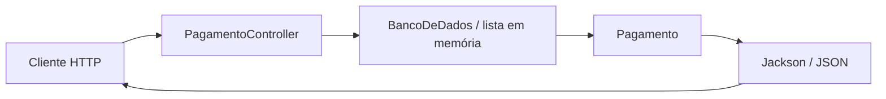

# Web Service de Pagamentos

**Uma API REST pequena para estudar como objetos Java se tornam recursos HTTP em JSON.**

Exemplo acadêmico com Spring Boot. O projeto expõe consultas a pagamentos fictícios e demonstra a separação entre objeto de domínio, fonte de dados e controller.

> É uma demonstração de consulta. Não processa pagamentos reais, não se conecta a um gateway e não utiliza banco persistente.

## Recursos da API

| Método | Rota | Resultado |
| --- | --- | --- |
| `GET` | `/pagamentos` | Lista os pagamentos de demonstração. |
| `GET` | `/pagamentos/hoje` | Filtra pelo vencimento igual à data atual do servidor. |
| `GET` | `/pagamentos/{id}` | Consulta pelo código; retorna `404` quando o registro não existe. |

A base é uma lista estática criada em memória com exemplos de energia, água, internet, cartão e aluguel. As datas dos exemplos são calculadas na inicialização; não representam contas de uma pessoa real.

## Executar

Requisitos documentados: **JDK 21** e Maven.

```bash
git clone https://github.com/dlr-1337/web-service-pagamentos.git
cd web-service-pagamentos
mvn spring-boot:run
```

A aplicação atende em **http://localhost:8080**. Em outro terminal:

```bash
curl http://localhost:8080/pagamentos
curl http://localhost:8080/pagamentos/hoje
curl http://localhost:8080/pagamentos/1
```

Os endpoints também podem ser abertos no navegador ou em um cliente HTTP.

## Arquitetura



| Arquivo | O que observar |
| --- | --- |
| [Pagamento.java](src/main/java/com/otavio/webservices/dominio/Pagamento.java) | Modelo do recurso e serialização de `LocalDate`. |
| [BancoDeDados.java](src/main/java/com/otavio/webservices/dados/BancoDeDados.java) | Dados estáticos e consultas com Streams. |
| [PagamentoController.java](src/main/java/com/otavio/webservices/controller/PagamentoController.java) | Rotas, respostas e tratamento de registro inexistente. |
| [pom.xml](pom.xml) | Dependências Spring Web, Jackson e configuração Maven. |

## Validar as consultas

Importe [web-service-pagamentos.postman_collection.json](web-service-pagamentos.postman_collection.json) no Postman e confira a variável `baseUrl`. Com Newman instalado, a mesma coleção pode ser executada no terminal:

```bash
newman run web-service-pagamentos.postman_collection.json \
  --env-var baseUrl=http://localhost:8080
```

A API precisa estar ativa durante a execução da coleção. Para explorar o comportamento, consulte um código existente, um inexistente e o filtro de vencimentos.

## Escopo

O foco é leitura de recursos REST, não criação de uma plataforma financeira. Não há cadastro de contas reais, conciliação, transferência de dinheiro ou persistência entre reinicializações. O projeto serve como base de estudo para evoluir uma camada de dados ou acrescentar novos contratos HTTP.
